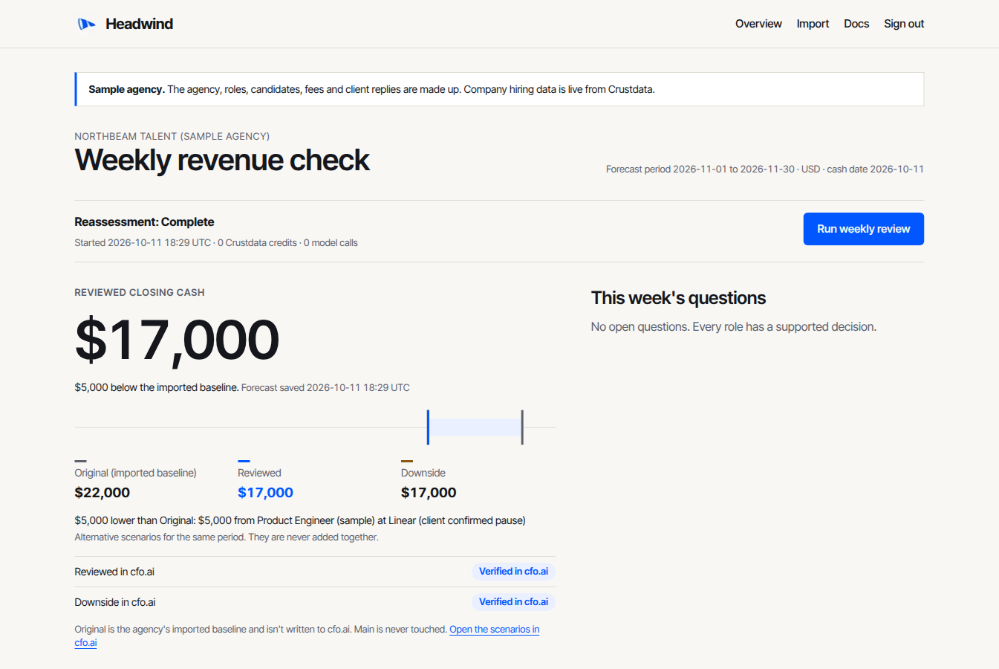
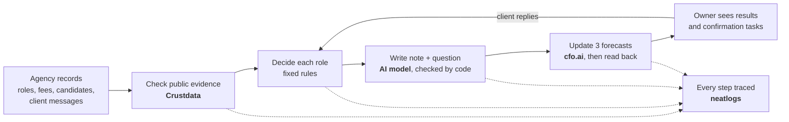
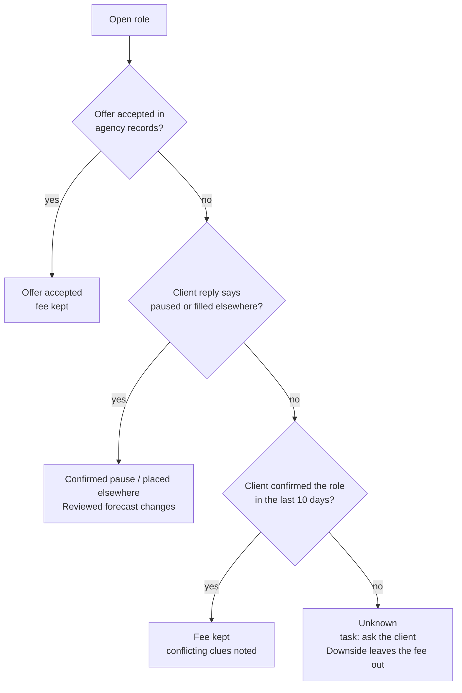
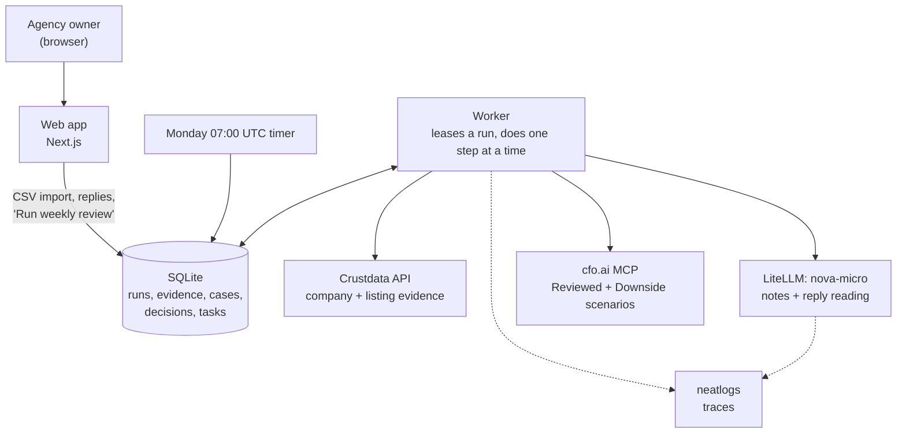

# Headwind

**Every Monday, Headwind checks which placement fees a recruitment agency can still count on, and updates its cash forecast.**

Live app: https://headwind-app.vercel.app (public pages; the app needs sign-in, sample agency) · Video: not available yet · Evaluation: [eval/REPORT.md](eval/REPORT.md) · Submission: not linked yet



**Built with:** Crustdata · cfo.ai · neatlogs · Entire · LiteLLM (`nova-micro`) · Next.js · SQLite · AWS EC2

**Status:** live on one AWS server with a sample agency. Company hiring data is real (Crustdata), the forecast lives in a real cfo.ai workspace, and the agency, its roles and every client reply are made up.

---

## The problem

A recruitment agency that fills permanent jobs gets paid only when a candidate starts. Its owner plans cash around fees that haven't arrived yet: "Retool's engineer role should pay $10,000 in November."

Those fees quietly go away. A client freezes hiring, fills the role through another agency, or just stops replying. Usually the owner finds out when the money doesn't arrive.

## What Headwind does

Once a week, for every open role, Headwind answers three questions:

1. **Does this fee still hold?** It looks at the agency's own records and the client company's public hiring data.
2. **What isn't confirmed?** It writes a short note and a neutral question for the recruiter to ask the client. It never guesses that a role was paused or filled.
3. **What does that do to cash?** It updates three forecasts in cfo.ai and checks that cfo.ai saved them:
   - **Original:** the owner's own numbers.
   - **Reviewed:** changed only by what a client actually confirmed.
   - **Downside:** leaves out every fee nobody has confirmed recently.

When the client answers, the owner pastes the reply in. Headwind updates just that role and keeps its earlier decisions on record.

## How the agent works, in plain words



1. **Read the agency's records.** The owner uploads clients, roles, fees and candidate stages as CSV files. Headwind shows any bad rows (a missing fee, a wrong date) before saving anything.
2. **Look up each client company in Crustdata.** It gets the company's open-role count over recent months and searches recent job listings for the specific role. Every result is saved with its date and source.
3. **Decide each role with fixed rules, not the AI.**
   - An accepted offer or a pause the client confirmed is settled straight away.
   - If the client hasn't confirmed the role in 10 days, or the listing has gone, the role becomes **unknown** and gets a confirmation task.
   - Company-wide hiring numbers and a missing listing are clues, never proof. A company can cut 30 roles and still hire for yours.
4. **Let the AI write only the note and the question.**
   - Code writes the important warnings itself, for example "Client last confirmed this role 33 days ago".
   - The AI sees only records those warnings don't already cover, and never sees fees, probabilities or the expected answers.
   - A checker rejects any note that claims an outcome the evidence doesn't show. It retries a few times, then falls back to a note built from the evidence.
5. **Update the forecast in cfo.ai.**
   - Each expected fee is worked out in code: fee × chance of placing.
   - Headwind writes the Reviewed and Downside numbers to their own cfo.ai scenarios, then reads them back. A write only counts once the readback matches.
   - The owner's Main scenario is never written to.
6. **Survive crashes.** Each step is saved before the next one starts. If the server dies halfway, the next worker carries on from the last saved step and first checks whether cfo.ai already received a write, so nothing is sent twice.

### How a role gets decided



## Tools used and where each one comes in

| Tool | What Headwind uses it for | Where it enters the flow |
|---|---|---|
| **Crustdata** | Company open-role counts over time, current openings, and a search of recent job listings for each role. About 6 credits per weekly review. | Step 2. Saved as dated evidence, shown under each role. |
| **cfo.ai** | Holds the agency's cash model. Headwind writes the Reviewed and Downside scenarios through cfo.ai's MCP server, then reads every value back. | Step 5. The "Verified (written)" column on the dashboard. |
| **neatlogs** | Traces every review run: each Crustdata call, model call and cfo.ai write, with timing and tokens. Used to compare before and after a fix. | Every step. One trace per run. |
| **Entire** | Records the agent session behind code changes as git checkpoints. The fix for a real failure (rejected case notes stopping the review) is checkpoint `01M4M8H1EAF08XSE3YWHHXGTT4`, made with Claude Code. | Development history, pushed to this repo. |
| **LiteLLM → `nova-micro`** | The only AI model the product uses. It writes case notes and reads client replies into a fixed set of answers, quoting the reply. | Steps 4 and 6. |
| **Claude Sonnet 4.6** | Testing only, not part of the product. It grades case notes independently of Headwind's own checker. | `scripts/grade-revised-notes.ts` |
| **Next.js + SQLite** | The web app, the background worker and the database that keeps every run, decision, piece of evidence and reply. | Everything the owner sees. |
| **AWS EC2 + Caddy** | One small server running the web app, the worker and a Monday 07:00 UTC timer, with HTTPS. | Hosting. |

## Architecture



A weekly review has 5 steps: `match_companies → check_listings → assess → forecast → sync_cfo`. A client reply runs the last 3, for that role only.

## Try it

1. Open https://headwind-app.vercel.app. The public page has a sample review you can click through without signing in, and **Docs** explains every screen.
2. Sign in (one team password, so ask the author for access). The Overview shows **Reviewed closing cash**, the Original / Reviewed / Downside gap, and whether each scenario is verified in cfo.ai.
3. **Roles**: open a role to see its decision, the dated evidence, the decision history and any client replies.
4. In **This week's questions**, paste a client reply. Tick "simulated" for test data. Only that role is reassessed.

No access? The evidence below and the [evaluation report](eval/REPORT.md) show the same runs in full.

## What's running

- **Public address:** Vercel, https://headwind-app.vercel.app. It serves the front page and docs, and passes sign-in, the app and the API to the server.
- **Server:** AWS EC2 (also reachable at https://54-164-50-152.sslip.io), running `main` at commit `2747d88` (deployed 2026-10-12).
- **Services:** web app, worker, Monday 07:00 UTC weekly timer, Caddy for HTTPS.
- **Data:** one sample agency, Northbeam Talent, with 3 roles at Retool, Linear and Vercel. 6 completed review runs so far.

## Evidence

All of this is on sample agency data with simulated client replies. The live runs used real Crustdata and real cfo.ai.

| What | Result | Where |
|---|---|---|
| Full live weekly review | `run_eac5efb75e90428e`: 5 of 5 steps done, 6 Crustdata credits, both cfo.ai scenarios read back correctly, Main untouched | [Report B1](eval/REPORT.md) |
| Live review on the latest code | `run_903b239b1dad49be`: 6 credits, 1 model call, neatlogs trace finalized (15 spans) | [Report A11](eval/REPORT.md) |
| A client reply that changes cash | "On hold until January" lowered Reviewed closing cash from $17,000 to $13,000. "Back on" restored it. cfo.ai readbacks matched both times. | PR [#5](https://github.com/CryptoZephyr/headwind/pull/5) |
| Crash in the middle of a run | The worker resumed from the saved step: 0 duplicate cfo.ai writes, 0 duplicate decisions | [Report B2](eval/REPORT.md) |
| Fixing a real failure | Before the fix, 9 of 20 reviews stopped on a rejected note (case-note acceptance 55% → 100%, 20 trials per version on two cases) | [Report A3](eval/REPORT.md) |
| Notes graded by a separate model | 97 of 97 case notes passed, with 0 claiming an outcome the evidence doesn't support (controlled test) | [Report A11](eval/REPORT.md) |
| Does Crustdata know real agency clients? | 4 more sample agencies with 40 real client companies: 35 matched and none matched wrongly (the other 5 were blocked); 23 matched with 6+ months of hiring history (UK firms only 4 of 10); 12 of 85 role searches found a listing | [Report B3](eval/REPORT.md) |
| AI never sees the answers | Test confirms that fees, probabilities, expected totals and outcome labels are never in the model's input | [Report A2](eval/REPORT.md) |
| Code checks | 99 tests, lint, typecheck and build pass | `npm test` |

## What we tested to make sure it fails safely

| Situation | What Headwind should do | What happened |
|---|---|---|
| Company-wide hiring dropped 48 → 13 | Note it as a clue, not as proof about this role | Kept the fee when the client had confirmed the role recently |
| A role's listing disappears | Ask the client; don't mark it paused or filled | Unknown, with a confirmation task |
| The AI writes "the role was paused, not cancelled" with no evidence | Reject the note | Rejected (9 of 9 unsupported test sentences caught, 0 of 8 cautious ones wrongly caught) |
| The cfo.ai write lands but the answer is lost | Check cfo.ai before resending | No duplicate write (Report B2) |
| A CSV with a bad fee or date | Show the error and save nothing | Rows are rejected before saving |
| Five wrong passwords | Lock sign-in | That address is locked for 15 minutes |

## Repository structure

```text
app/         web pages and API routes (dashboard, import, login, replies, reviews)
components/  review controls, reply form, sample loader
lib/         the engine: policy.ts (rules), review.ts (steps), llm.ts (notes + checker),
             crustdata.ts, cfo.ts, scenarios.ts (forecast maths), store.ts, importer.ts
worker/      background worker that runs reviews step by step
scripts/     live review, cfo.ai setup, evaluation and grading scripts
tests/       Vitest tests (rules, engine, importer, checker, forecast maths)
eval/        evaluation report and saved results
deploy/      systemd services, weekly timer, Caddy, install and recovery-test scripts
fixtures/    sample CSV files (sample/ is the live sample agency; agencies/ holds the 4 coverage-test agencies)
```

## Run locally

```bash
npm install
cp .env.example .env.local     # add your keys and a HEADWIND_PASSWORD
npx tsx scripts/seed-sample.ts # optional: the labelled sample agency
npm run dev                    # web app on http://localhost:3000
npm run worker                 # runs queued reviews (restart it after code changes)
```

- **cfo.ai:** `npx tsx scripts/cfo-setup.ts` creates the sample agency's Reviewed and Downside test scenarios in cfo.ai. It never touches Main.
- **Checks:** `npm run lint && npm run typecheck && npm test && npm run build`.
- **Import files:** CSV templates are in `fixtures/sample/`. Money is whole USD, probability is a percentage, and dates are YYYY-MM-DD.
- **Deploying:** `deploy/` runs everything on one Ubuntu 24.04 server. Put the keys in `/etc/headwind/env`, set `HEADWIND_HOST` in `/etc/headwind/caddy.env`, then run `sudo /opt/headwind/deploy/install.sh`.
- **One public address (Vercel):** deploy the same repo to Vercel with `HEADWIND_UPSTREAM` (the server's URL) and `HEADWIND_PROXY_KEY`. Vercel serves the landing page and docs, and passes `/login`, `/app`, `/import` and `/api` to the server. On the server, set the same `HEADWIND_PROXY_KEY` and `HEADWIND_ASSET_PREFIX=/_hw`. The database, worker and keys stay on the server.

## Cost to an agency

- **cfo.ai:** Startup at $500 a month is the cheapest plan that includes the MCP access Headwind uses. That price is verified from the workspace's billing readback. Headwind has only run on cfo.ai's Growth plan so far.
- **Headwind:** $300 a month is a guess and hasn't been tested with any agency.
- **Total:** an agency bringing its own cfo.ai account would pay about $800 a month. Crustdata and model costs are included in Headwind's price, at about 6 Crustdata credits per weekly review. Details are in [Report C](eval/REPORT.md).

## Limitations

- **Only sample data:** one made-up agency, with simulated client replies. No real agency has used it, and forecast accuracy over time isn't proven.
- **Thin public data for smaller firms:** in the 40-company test, about 4 in 10 clients had no usable hiring history, and most role searches found no listing. For those clients Headwind relies on the agency's own records and client confirmations.
- **Clues, not answers:** Crustdata has no past listing history for a role, so the first check only sets a starting point. Missing listings and company-wide numbers stay clues.
- **The AI can still overreach:** in one test run, the AI read "Let's pick this up on our call next week" as "resuming" the role. The checker uses a fixed list of outcome words and missed it.
- **Grading:** notes are graded by one model, Claude Sonnet 4.6. No person has checked its grades.
- **Single sign-in:** one shared password, and one agency per server.
- **Trial access:** the Crustdata credits and the cfo.ai trial used here expire on 2026-10-24.

## Next steps

- Run it on a real agency's anonymised records for a few weeks and compare the Downside forecast with the fees that actually arrived.
- Let the owner confirm a blocked company match by hand (4 of the 5 blocked companies in the coverage test could be recovered this way).
- Show plainly when Crustdata has no hiring data for a client, so the owner knows why a role has less evidence.
- Add a code-written warning for rising company hiring, matching the one for falling hiring.
- Support more than one agency per server, with a separate sign-in for each.

## License and security

Headwind is open source under the [MIT License](LICENSE). To report a security problem, see [SECURITY.md](SECURITY.md).
